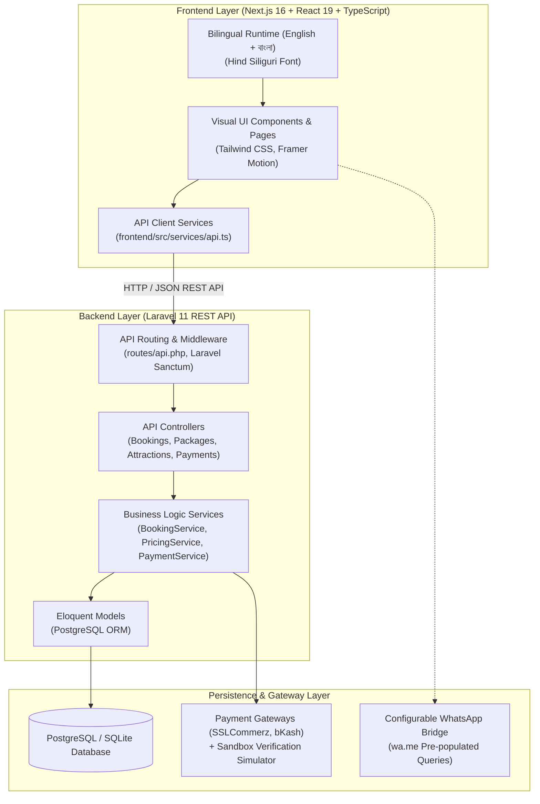
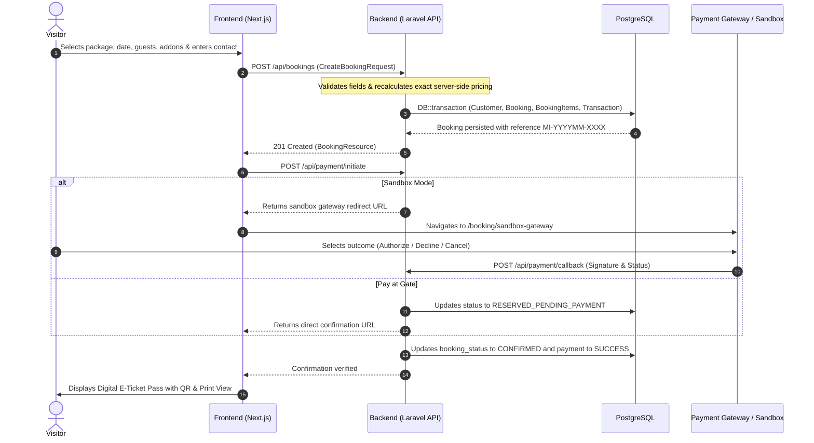

# Magic Island — System Architecture Documentation

## 1. High-Level Architecture Overview

Magic Island is architected as a decoupled, multi-tier amusement park management and visitor platform:

---

## 2. Component Layer Responsibilities

### A. Frontend Layer (`frontend/`)
- **Framework**: Next.js 16 (App Router) with React 19, TypeScript, and Tailwind CSS.
- **Client Presentation**: All visitor-facing pages (`/`, `/water-park`, `/dino-zone`, `/amusement-park`, `/attractions`, `/tickets`, `/booking`, `/gallery`, `/events`, `/location`).
- **State & Localization**: Persistent bilingual context (`useTranslation` with `localStorage` and `NEXT_LOCALE` cookie), custom Google Font injection (`Hind_Siliguri` for Bangla and `Plus_Jakarta_Sans` for English).
- **Service Decoupling**: Frontend never executes database queries or computes authoritative financial transactions. All data operations communicate through typed service methods in `src/services/api.ts`.
- **Defensive UI**: Loading skeletons, error notifications, and verified feedback states for all forms and queries.

### B. Backend Layer (`backend/`)
- **Framework**: Laravel 11.x on PHP 8.3.
- **API Security**: Stateless REST API secured by Laravel Sanctum API tokens and CORS middleware.
- **Form Validation**: Strict Laravel `FormRequest` classes (`CreateBookingRequest`, `InitiatePaymentRequest`, `PaymentCallbackRequest`) ensuring zero malformed payloads reach controllers.
- **Service-Oriented Architecture**:
  - `PricingService`: Authoritative mathematical engine calculating ticket packages, child age exemptions, add-on costs, promo code discounts, and 5% entertainment VAT.
  - `BookingService`: Reference generation (`MI-YYYYMM-XXXX`), customer identity resolution, and database transaction consistency.
  - `PaymentService`: Payment gateway dispatch and IPN signature callback processing.
- **Database Engine**: PostgreSQL with full Eloquent model relationships, foreign key constraints, indexes on booking references and customer contact details.

---

## 3. Core Data Workflows

### 3.1 Booking & Reservation Lifecycle

---

## 4. Security Principles
1. **Zero Client Trust**: Frontend pricing is never accepted by the server. All subtotals, discounts, and taxes are recalculated from the database during booking creation.
2. **Environment Secret Isolation**: Merchant IDs, store passwords, and database credentials remain exclusively on the server in `backend/.env`.
3. **No Simulated Success in Production**: In production mode, transactions are only marked as confirmed upon verified server-to-server gateway callback.

